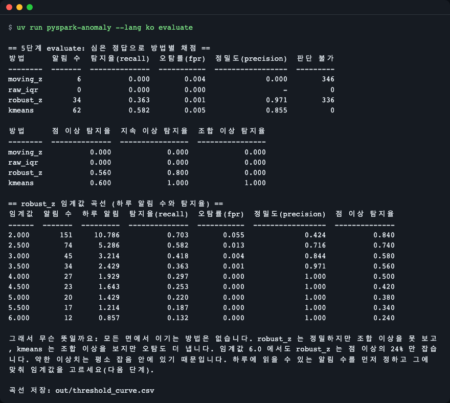
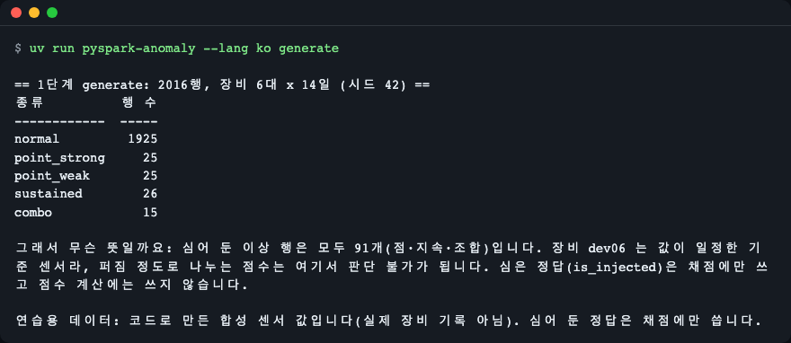
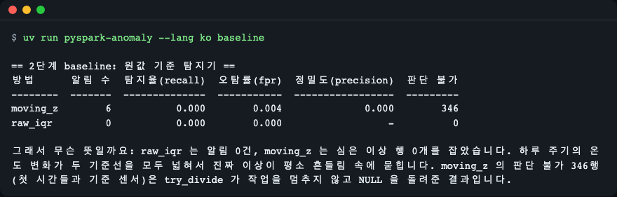
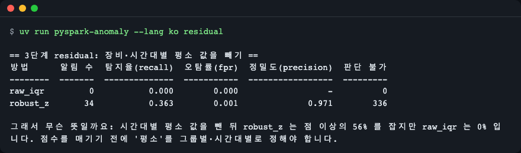
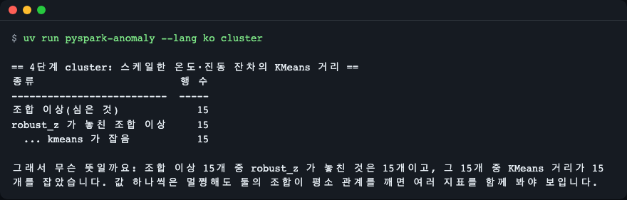
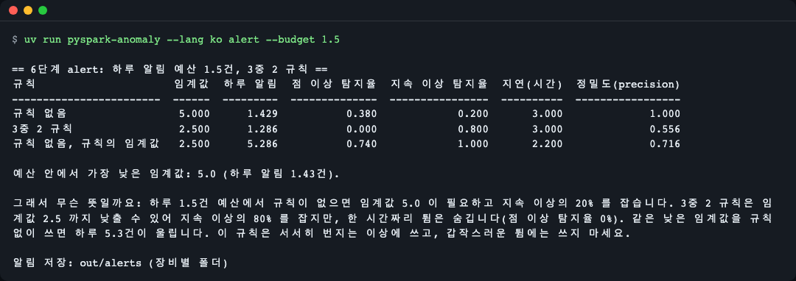
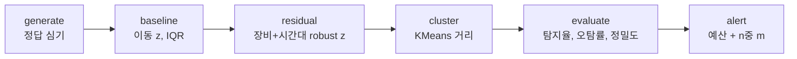
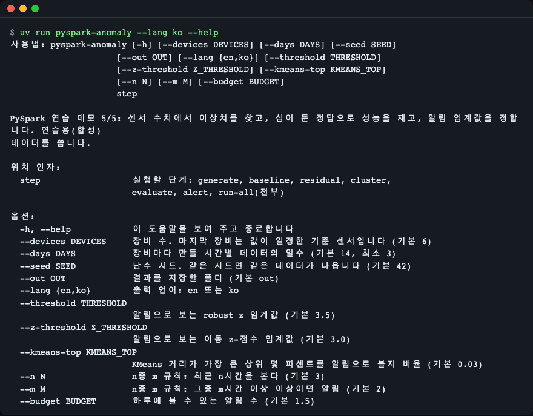

# ai-lab-pyspark-anomaly-detection — PySpark로 센서 수치의 이상치를 찾고, 성능을 재고, 알림 임계값을 정하기

[English](README.md) | **한국어**

PySpark 실습 데모(5편 시리즈 중 5편)입니다. 센서 수치에서 장비별·시간대별 기준선을 만들고, z-점수·IQR·robust z·KMeans 거리로 이상 점수를 매긴 뒤, 코드가 직접 심어 둔 이상치(정답)로 모든 방법의 탐지율·오탐률·정밀도를 재고, 하루 알림 예산에서 알림 임계값을 고릅니다. 합성 데이터와 PySpark 내장 기능만 쓰고 오프라인으로 돌며, 명령 하나로 전부 실행됩니다: `uv run pyspark-anomaly run-all`.

시리즈는 쉬운 계산에서 시작해 실무형 문제로 갑니다. 각 편은 혼자 실행하고 읽어도 됩니다.

| 편 | 주제 | 레포 |
|---|---|---|
| 1 | 집계(합계, 그룹별 계산) | ai-lab-pyspark-sales-aggregation |
| 2 | 회귀(숫자 예측) | ai-lab-pyspark-price-regression |
| 3 | 시계열 예측 | ai-lab-pyspark-demand-forecast |
| 4 | 분류(이탈) | ai-lab-pyspark-churn-scoring |
| **5** | **이상치 탐지(이 편, 정답 라벨 없음)** | **ai-lab-pyspark-anomaly-detection** |


<sub>마지막 보고서: 모든 방법을 심어 둔 정답으로 채점한 표, 그리고 임계값에 따라 탐지율과 알림 수가 어떻게 변하는지.</sub>

## 한 줄 요약

끝까지 따라 하면 그룹별로 이상 점수를 매기고, 진짜 이상치를 얼마나 잡고 오탐이 얼마나 나는지 재고, "하루에 알림을 몇 건 읽을 수 있나"에서 알림 임계값을 정할 수 있습니다.

이 편에서 할 수 있게 되는 것:

1. 그룹(장비)별·시간대별 "평소" 값을 만듭니다.
2. z-점수, IQR, robust z(중앙값과 MAD), KMeans 거리로 이상 점수를 매깁니다.
3. 심어 둔 정답으로 탐지율·오탐률·정밀도를 잽니다.
4. "하루에 알림을 몇 건 읽을 수 있나"에서 출발해 임계값과 n중 m 규칙을 고릅니다.

**이런 분께:** PySpark DataFrame 기본을 아는 분 중 현실적인 이상 탐지 흐름을 보고 싶은 분, 알림 임계값을 감으로 정해 본 분, "원값의 평균 ± 3 표준편차"가 왜 자주 실패하는지 보고 싶은 분.

## 왜 알아야 하나요?

야간 경비원이 소리를 듣는다고 생각해 보세요. 새벽 3시의 소음은 이상하지만 같은 소음이 한낮에는 정상입니다. 경비원이 모든 소리를 "하루 전체의 평균 소음"과 비교하면 아무것도 두드러지지 않고, 시끄러운 한낮에 조용한 시간의 문제가 묻힙니다. 좋은 경비원은 장소와 시간마다 평소 소음을 알고, 밤새 처리할 수 있는 경보 횟수도 미리 정해 둡니다. 이 데모는 숫자로 같은 일을 합니다: 장비·시간대별 평소 값, 남은 차이의 점수, 예산에서 고른 알림 임계값.

## 30초 만에 실행하기

Python 3.11+, [uv](https://docs.astral.sh/uv/)(`curl -LsSf https://astral.sh/uv/install.sh | sh`), Java 17+ 가 필요합니다(PySpark 는 JVM 위에서 돕니다. macOS: `brew install openjdk@21`, Debian/Ubuntu: `sudo apt-get install -y openjdk-21-jre-headless`).

```bash
git clone https://github.com/LeeGyeongPil/ai-lab-pyspark-anomaly-detection.git
cd ai-lab-pyspark-anomaly-detection
uv run pyspark-anomaly run-all
```

노트북에서 약 15초 걸립니다. API 키도, 설치 이후 다운로드도, 네트워크도 필요 없습니다. 데이터는 코드가 만듭니다(장비 6대 × 14일 시간별 값, 시드 42). 실제 장비가 아니라 연습용 데이터입니다. 목(mock) 모드는 없고 모든 것이 로컬에서 실제로 돕니다.


<sub>1단계(`generate`): 만들어진 데이터와 심어 둔 이상치.</sub>

출력 언어는 `--lang en|ko`, `PYSPARK_ANOMALY_LANG` 환경변수, `LANG`(`ko` 로 시작하면 한국어, 아니면 영어)으로 고릅니다. 우선순위: `--lang` > `PYSPARK_ANOMALY_LANG` > `LC_ALL`/`LC_MESSAGES`/`LANG` > 영어.

## 단계별로 따라 하기

각 단계는 결과를 `out/<단계>/` 에 저장하고 다음 단계가 그것을 읽으므로 한 단계씩 실행할 수 있습니다. 입력이 없으면 종료 코드 2 와 함께 먼저 `generate` 를 실행하라고 안내합니다.

### 1단계. 정답을 심은 데이터 만들기

```bash
uv run pyspark-anomaly generate
```

2016행(장비 6대 × 14일 × 24시간)과 심은 이상치 네 종류의 개수가 보입니다. `point_strong`(한 시간, 정상에서 크게 벗어남), `point_weak`(한 시간, 잡음 범위를 간신히 벗어남), `sustained`(4~8시간 서서히 번지는 드리프트, 사건 5개), `combo`(온도와 진동이 각각은 그럴듯하지만 둘의 조합이 비정상). 마지막 장비는 값이 일정한 기준 센서입니다. 정답 열(`is_injected`, `anomaly_type`, `event_id`)은 채점에만 쓰고 점수 계산에는 쓰지 않습니다.

왜 이렇게 심었을까요? 실제 기록에는 정답표가 없어서 탐지기가 얼마나 잘하는지 알 수 없습니다. 알고 있는 이상치를 일부러 심으면 정답표가 생깁니다. 종류마다 교훈이 하나씩 있습니다. 약한 점 이상은 어떤 임계값도 전부 잡지 못한다는 것, 지속 이상은 n중 m 규칙이 왜 필요한지, 조합 이상은 두 측정값을 함께 봐야 하는 이유, 값이 일정한 기준 센서는 0 으로 나누기를 어떻게 다루는지를 보여 줍니다.

### 2단계. 원값 기준선

```bash
uv run pyspark-anomaly baseline
```


<sub>원값 기준 탐지기 둘 다 심어 둔 이상치를 0개 잡습니다.</sub>

고전적인 탐지기 둘이 원래 온도를 봅니다: 이동 z-점수(같은 장비의 직전 24시간과의 거리)와 IQR 울타리. 알림은 6건과 0건이고 심은 이상치는 하나도 못 잡습니다. 하루 온도 주기(±8도)가 기준을 넓혀 진짜 이상치가 정상 변동 안에 숨기 때문입니다. `판단 불가 346` 은 표준편차 0 으로 나누게 되는 행의 수입니다("용어 사전" 참고).

### 3단계. 장비·시간대별 평소 값 빼기

```bash
uv run pyspark-anomaly residual
```


<sub>장비·시간대별 평소 값을 뺀 뒤 robust z 는 점 이상의 56% 를 찾고, 원값 IQR 은 0% 입니다.</sub>

평소 값은 같은 장비·같은 시각의 중앙값입니다. 남은 차이(잔차)를 robust z `|잔차| / (1.4826 × MAD)` 로 점수 냅니다. 중앙값과 MAD 는 이상치 자신에게 끌려가지 않습니다. 교훈: 점수를 매기기 전에 그룹별·시간대별로 "정상"을 먼저 정의하세요.

### 4단계. KMeans 로 두 측정값을 함께 보기

```bash
uv run pyspark-anomaly cluster
```


<sub>조합 이상 15개를 robust z 는 모두 놓쳤고 KMeans 거리는 15개를 모두 잡았습니다.</sub>

조합 이상은 온도도 진동도 각각 정상처럼 보이지만 둘의 짝이 평소 관계(진동은 보통 온도에 비례)를 깹니다. VectorAssembler, StandardScaler, KMeans 로 각 행에서 가장 가까운 군집 중심까지의 거리를 스케일된 공간에서 잽니다. 대가는 다음 단계에서 보입니다: KMeans 는 오탐이 더 많습니다(알림 62건, 정밀도 0.855 대 0.971).

### 5단계. 심은 정답으로 모두 채점하기

```bash
uv run pyspark-anomaly evaluate
```

맨 위 대표 화면입니다. 읽는 법:

| 방법 | 보이는 것 |
|---|---|
| `moving_z`, `raw_iqr` | 탐지율 0.000: 원값은 이상치를 가립니다 |
| `robust_z` (임계값 3.5) | 알림 34건, 정밀도 0.971, 점 이상 0.56, 지속 이상 0.80, 조합 0.00 |
| `kmeans` (상위 3%) | 알림 62건, 점 0.60, 지속 1.00, 조합 1.00, 오탐률 0.005 |

임계값 곡선에서 robust z 임계값을 2.0 에서 6.0 으로 올리면 하루 알림이 10.8건에서 0.86건으로 줄고 점 이상 탐지율은 0.84 에서 0.24 로 떨어집니다. 약한 이상치는 정상 잡음 안에 있어서 어떤 임계값도 전부 잡지 못합니다. 곡선은 `out/threshold_curve.csv` 에도 저장됩니다.

### 6단계. 알림 예산에서 임계값 정하기

```bash
uv run pyspark-anomaly alert --budget 1.5
```


<sub>하루 1.5건 예산: 규칙이 없으면 임계값은 5.0, 3중 2 규칙을 쓰면 2.5 까지 낮출 수 있습니다.</sub>

"하루 1.5건은 읽을 수 있다"에서 출발해 예산에 맞는 가장 낮은 임계값을 고릅니다(5.0, 하루 1.43건, 지속 이상의 20% 탐지). 3중 2 규칙(최근 3시간 중 2시간 이상 이상일 때만 알림)은 한 시간짜리 튐을 숨기므로 같은 예산에서 임계값이 2.5 까지 내려가 지속 이상의 80% 를 잡습니다. 대신 점 이상 탐지율은 0% 입니다. 서서히 번지는 이상에 쓰고 갑작스러운 튐에는 쓰지 마세요. 알림은 `out/alerts/device=*/` 에 저장됩니다.

다른 규칙도 해 보세요: `uv run pyspark-anomaly alert --budget 1.5 --n 4 --m 3` 은 4중 3 규칙에 임계값 2.0 이 나옵니다(지속 이상 0.80, 점 이상 0.02). `--budget` 은 0보다 커야 하며, 가장 높은 임계값도 예산을 넘으면 그렇다고 알려 주고 가장 높은 임계값(여기서는 6.0)을 가장 덜 나쁜 선택으로 보여 준 뒤 알림을 저장하고 종료 코드 0 으로 끝납니다.

## 어떻게 동작하나요?



- `generate` 는 센서 행을 만들고 정답은 별도 열에 둡니다.
- `baseline` 은 원값에 점수를 매기는데 하루 주기가 흐려 놓습니다.
- `residual` 은 장비·시간대별 중앙값을 빼고 robust z 로 점수를 냅니다.
- `cluster` 는 온도·진동 잔차를 합쳐 스케일한 뒤 가장 가까운 KMeans 중심까지의 거리를 잽니다.
- `evaluate` 는 각 방법의 알림을 심어 둔 정답과 비교합니다.
- `alert` 는 하루 예산을 임계값으로 바꾸고 n중 m 규칙을 시험합니다.

## 코드 둘러보기

| 파일 | 하는 일 |
|---|---|
| [`src/anomaly_lab/baseline.py`](src/anomaly_lab/baseline.py) | 이동 z-점수 창과 IQR 울타리 |
| [`src/anomaly_lab/residual.py`](src/anomaly_lab/residual.py) | 장비+시간대 중앙값, MAD, robust z |
| [`src/anomaly_lab/cluster.py`](src/anomaly_lab/cluster.py) | VectorAssembler, StandardScaler, KMeans, 스케일 공간 거리 |
| [`src/anomaly_lab/evaluate.py`](src/anomaly_lab/evaluate.py) | 탐지율·오탐률·정밀도, 임계값 곡선 |
| [`src/anomaly_lab/alert.py`](src/anomaly_lab/alert.py) | 예산 임계값과 n중 m 규칙 |
| [`src/anomaly_lab/i18n.py`](src/anomaly_lab/i18n.py) | 영어·한국어 메시지 |

읽어 볼 만한 곳 3군데:

1. 창은 현재 행을 빼고, `try_divide` 는 실패하는 대신 NULL 을 돌려줍니다(Spark 4 는 ANSI 모드라 일반 `/` 로 0 을 나누면 작업이 멈춥니다):

   ```python
   w = Window.partitionBy("device").orderBy("t").rowsBetween(-window, -1)
   df.withColumn("mu", F.avg("temp").over(w)) \
     .withColumn("sd", F.stddev("temp").over(w)) \
     .withColumn("z", F.try_divide(F.col("temp") - F.col("mu"), F.col("sd")))
   ```

   현재 행을 포함하면 큰 튐이 자기 평균을 끌어올려 스스로를 가립니다.

2. 그룹·시간대별 "평소" 값은 근사 중앙값을 씁니다. 클러스터에서도 비용이 적습니다:

   ```python
   usual = df.groupBy("device", "hour").agg(F.percentile_approx("temp", 0.5).alias("temp_med"))
   ```

3. n중 m 규칙은 최근 n시간의 창 합계입니다:

   ```python
   anomalous = F.coalesce(F.col(score_col) > threshold, F.lit(False)).cast("int")
   F.sum(anomalous).over(_window(n)) >= m
   ```

## 용어 사전

| 용어 | 뜻 |
|---|---|
| 기준선(baseline) | 측정값을 비교하는 "평소" 값이나 범위 |
| z-점수 | 값이 평균에서 표준편차의 몇 배 떨어졌는지 |
| IQR 울타리 | Tukey 규칙: Q1 - 1.5 × IQR 보다 작거나 Q3 + 1.5 × IQR 보다 크면 이상치(IQR = Q3 - Q1) |
| MAD / robust z | 중앙값 절대 편차. robust z 는 평균·표준편차 대신 중앙값·MAD 를 써서 이상치에 흔들리지 않음 |
| 잔차 | 값에서 그 그룹·시간대의 평소 값을 뺀 것 |
| KMeans 거리 | 한 행에서 가장 가까운 군집 중심까지의 거리. 멀수록 특이함 |
| 탐지율(recall) | 심은 이상치 중 알림이 울린 비율 |
| 오탐률 | 정상 행 중 알림이 울린 비율 |
| 정밀도(precision) | 알림 중 진짜 이상치의 비율 |
| 판단 불가 | 점수가 NULL(예: 표준편차 0). 실패하지 않고 따로 셈 |
| ANSI 모드 | Spark 4 기본값: 0 으로 나누기 같은 잘못된 연산은 오류를 냄 |
| n중 m 규칙 | 최근 n시간 중 m시간 이상 이상일 때만 알림 |

## 같은 방법을 결제 금액에 옮기면

이 데모에는 센서 데이터만 들어 있습니다. 같은 단계를 결제 기록에도 쓸 수 있고, 아래 표는 각 요소가 무엇으로 바뀌는지 보여 줍니다. 내 데이터에 옮길 때 참고하는 안내이며, 이 저장소가 실행하는 기능은 아닙니다.

| 이 데모 | 결제 금액에서는 |
|---|---|
| 장비(device) | 가맹점 |
| 시간대 | 시간대와 요일 |
| `temp`(온도) | `amount`(금액). 작은 금액이 많고 큰 금액이 드물어 한쪽으로 치우치므로 로그 변환을 권장 |
| `vib`(진동) | 거래 건수, 또는 건당 평균 금액(객단가) |
| 점 이상 | 한 번의 유난히 큰 결제 |
| 지속 이상 | 며칠에 걸쳐 서서히 오르거나 내려가는 매출 |
| 조합 이상 | 금액은 평소 같은데 거래 건수가 비정상 |
| 값이 일정한 기준 센서 | 요금이 고정된 가맹점(MAD 0, 판단 불가) |
| 알림 예산 | 검토 담당자가 하루에 확인할 수 있는 건수 |

결제 데이터에는 심어 둔 정답이 없습니다. 탐지기를 채점하려면 과거에 확인된 사례(예: 조사가 끝난 부정 결제나 환불)를 쓰거나, 이 데모처럼 데이터 복사본에 합성 사례를 심어서 재세요.

## 직접 바꿔 보기

1. **다른 시드** — `uv run pyspark-anomaly run-all --seed 7` → 숫자는 바뀌지만(시드 7 에서는 하루 1.5건 예산이 임계값 6.0 을 고르고 3중 2 규칙이 지속 이상의 60% 를 잡음) 이야기는 그대로 → 표를 비교하세요.
2. **더 엄격한 robust z** — `uv run pyspark-anomaly run-all --threshold 5` → robust_z 알림 20건, 정밀도 1.000, 탐지율 0.220(지속 이상 0.20) → `robust_z` 행을 확인하세요.
3. **더 작은 KMeans 컷** — `uv run pyspark-anomaly run-all --kmeans-top 0.01` → kmeans 알림 22건, 정밀도 1.000, 하지만 조합 이상 탐지율이 1.00 에서 0.07 로 떨어짐 → `kmeans` 행과 조합 열을 확인하세요.

작고 빠르게 돌려 보려면 `--devices 3 --days 3` 도 해 보세요.

## 자주 겪는 문제

| 증상 | 원인 | 해결 |
|---|---|---|
| 설치 안내와 함께 종료 코드 2 | Java 를 못 찾거나 17 미만 | Java 17+ 설치 또는 `JAVA_HOME` 설정 |
| `JAVA_GATEWAY_EXITED` | JVM 이 시작되지 못함 | `java -version`, `JAVA_HOME` 확인 |
| `입력이 없습니다: out/data 을(를) 찾지 못했습니다` | 앞 단계보다 먼저 실행함 | `generate` 먼저, 또는 `run-all`. `--out` 확인 |
| stderr 의 `Picked up JAVA_TOOL_OPTIONS ...` | JVM 이 기존 환경 옵션을 알림 | 무해함 |
| 첫 시작이 느림 | Spark 가 로컬 JVM 을 띄움 | 기다리세요. 이후 단계는 저장된 `out/` 을 씀 |
| `인자가 올바르지 않습니다...` 와 `문제: --devices 의 값이 올바르지 않습니다: abc`, 종료 코드 2 | 단계 이름 오류, 모르는 옵션, 값의 형식 오류. `문제:` 줄이 어느 것인지 알려 줌 | 그 옵션을 고치세요. `uv run pyspark-anomaly --lang ko --help` 참고 |
| 직접 짠 코드에서 `[DIVIDE_BY_ZERO]` | Spark 4 는 ANSI 모드라 일반 `/` 로 0 을 나누면 작업이 멈춤 | 이 데모처럼 NULL 을 돌려주는 `F.try_divide(a, b)` 를 쓰세요 |
| `ModuleNotFoundError: No module named 'numpy'` | `pyspark.ml`(VectorAssembler, KMeans)은 numpy 가 필요한데 `pip install pyspark` 만으로는 설치되지 않음 | 이 폴더에서 `uv sync`(numpy 고정됨), 또는 `pip install "pyspark[ml]"` |
| `kmeans` 숫자가 이 README 와 다름 | 다른 `--seed`, 또는 바뀐 KMeans 시드(`cluster.py` 에서 `seed=7` 로 고정) | 기본값 `--seed 42` 를 쓰고 KMeans 시드를 고정하세요. 시드가 바뀌면 숫자는 바뀌어도 이야기는 같습니다 |

Spark 임시 파일은 `SPARK_LOCAL_DIRS` 가 없으면 `./.spark-tmp/` 에 쌓입니다.

테스트는 `uv run pytest -q` 로 돌립니다(약 20초, Spark 세션 하나를 공유).

## 한계와 다음 걸음

- **합성 데이터입니다.** 숫자는 고정 시드로 코드가 만든 것입니다. 시드가 다르면 숫자도 다릅니다("직접 바꿔 보기" 참고). 실제 데이터는 "같은 방법을 결제 금액에 옮기면"처럼 따로 검증해야 합니다.
- **배치 계산만 합니다.** 각 단계는 저장된 파일을 읽고 끝납니다. 실시간 알림이 필요하면 같은 창과 규칙을 Spark Structured Streaming(Spark 의 스트리밍 엔진)에서 돌리는 방향이 있습니다. 이 데모는 다루지 않습니다.
- **`moving_z` 는 일부러 약한 기준선입니다.** 하루 주기를 무시하므로 비교용으로만 둡니다.
- **여러 측정값을 함께 보는 더 강한 탐지기**(Isolation Forest 등)는 JVM 패키지를 따로 추가해야 합니다(아래 링크). 이 데모는 PySpark 내장 기능만 씁니다.

## 더 알아보기

- [PySpark 설치 문서(Python 3.11+, Java 17+)](https://spark.apache.org/docs/latest/api/python/getting_started/install.html)
- [Spark ML 군집: KMeans](https://spark.apache.org/docs/latest/ml-clustering.html)
- [`percentile_approx`](https://spark.apache.org/docs/latest/api/python/reference/pyspark.sql/api/pyspark.sql.functions.percentile_approx.html)
- [Spark 4.3.0 릴리스 노트](https://spark.apache.org/releases/spark-release-4-3-0.html)
- Spark 에서 실무용 이상 탐지는 [Deequ](https://github.com/awslabs/deequ), [isolation-forest](https://github.com/linkedin/isolation-forest), [SynapseML Isolation Forest](https://microsoft.github.io/SynapseML/docs/1.0.5/Explore%20Algorithms/Anomaly%20Detection/Quickstart%20-%20Isolation%20Forests/) 를 보세요. 링크 확인일 2026-11-15.

명령줄 도움말: 

## 라이선스

MIT — [LICENSE](LICENSE). 데이터는 합성이며 이 저장소의 코드가 만듭니다.
