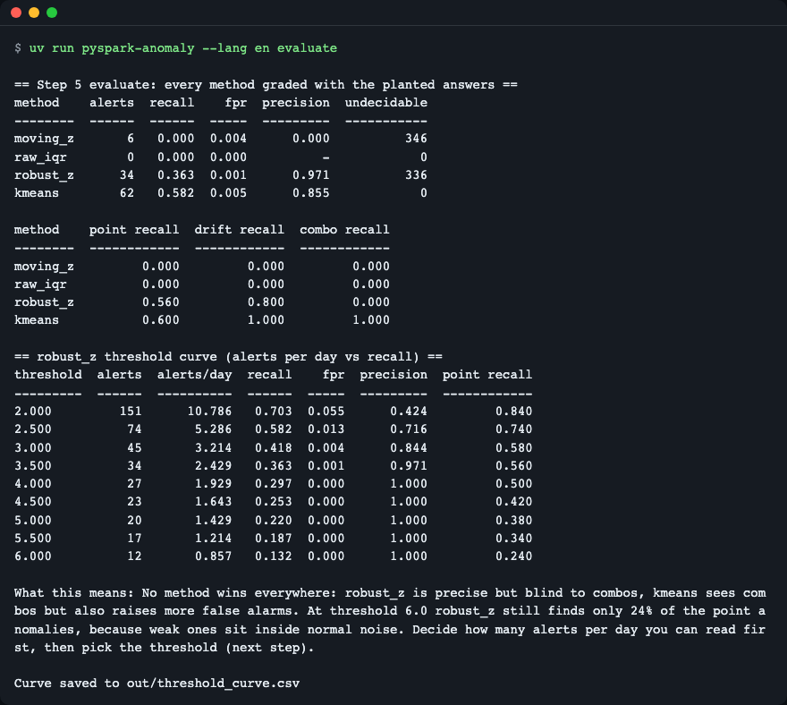
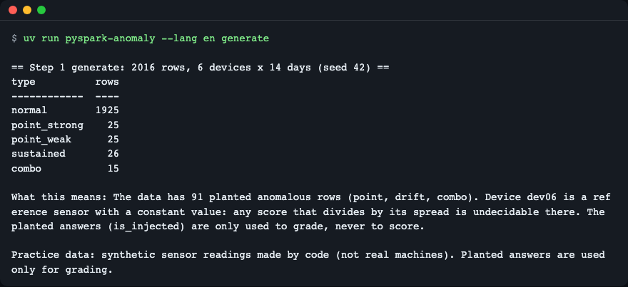
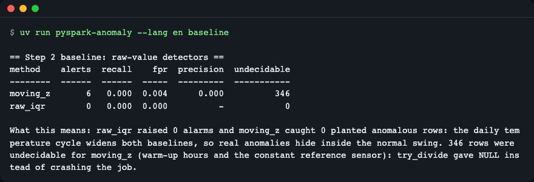
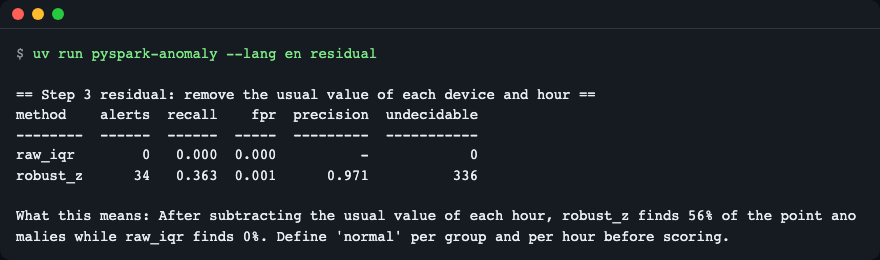
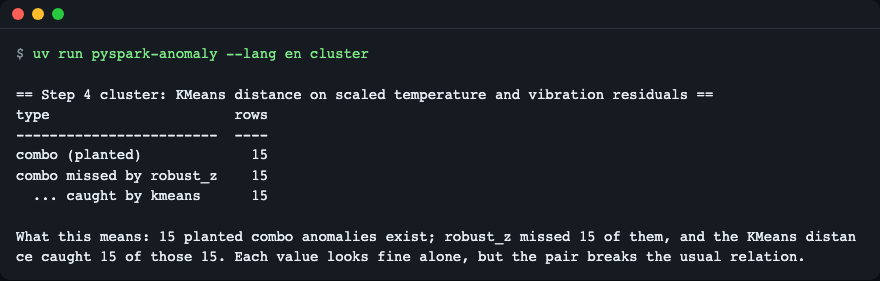
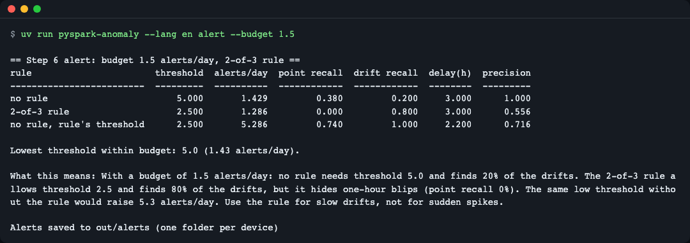
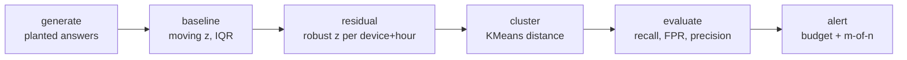
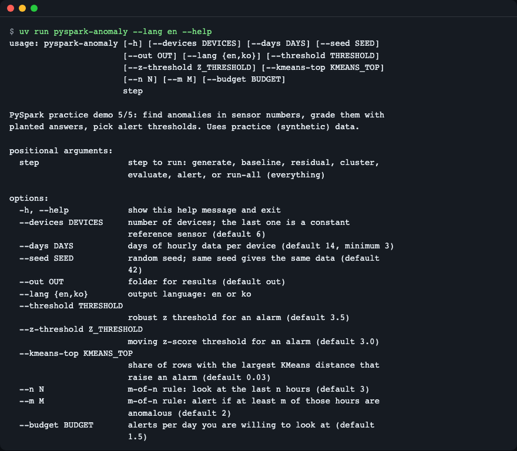

# ai-lab-pyspark-anomaly-detection — find anomalies in sensor numbers with PySpark, grade them, pick an alert threshold

**English** | [한국어](README.ko.md)

A hands-on PySpark practice demo (part 5 of a 5-part series). It builds per-device, per-hour baselines from sensor readings, scores anomalies with z-score, IQR, robust z and KMeans distance, then grades every method with the anomalies it planted itself (recall, false-positive rate, precision) and picks an alert threshold from a daily alert budget. One command runs everything on synthetic data, offline, with only PySpark built-ins: `uv run pyspark-anomaly run-all`.

The series goes from easy calculations to a practical problem. Each part runs and reads on its own.

| Part | Topic | Repository |
|---|---|---|
| 1 | Aggregation (sums, group-by) | ai-lab-pyspark-sales-aggregation |
| 2 | Regression (predict a number) | ai-lab-pyspark-price-regression |
| 3 | Time-series forecasting | ai-lab-pyspark-demand-forecast |
| 4 | Classification (churn) | ai-lab-pyspark-churn-scoring |
| **5** | **Anomaly detection (this part, no labels)** | **ai-lab-pyspark-anomaly-detection** |


<sub>The final report: every method graded against the planted answers, and how recall and alert volume change with the threshold.</sub>

## In one line

Follow this demo to the end and you can score anomalies per group, measure how many real ones you catch and how many false alarms you raise, and choose an alert threshold from "how many alerts can I read per day".

What you will be able to do:

1. Build a "usual" value per group (device) and per hour.
2. Score anomalies with z-score, IQR, robust z (median and MAD) and KMeans distance.
3. Measure recall, false-positive rate and precision with planted answers.
4. Start from "how many alerts can I read per day" and pick a threshold and an m-of-n rule.

**Good for:** people who know basic PySpark DataFrames and want a realistic anomaly-detection workflow; anyone who has set an alert threshold by guessing; readers who want to see why "mean ± 3 sd on the raw value" often fails.

## Why this matters

Think of a night guard who hears a noise. A noise at 3 a.m. is odd, the same noise at noon is normal. If the guard compares everything with "the average noise of the whole day", nothing stands out and the loud noon hours drown the quiet-hour problems. A good guard knows the usual noise for each place and each hour, and also decides in advance how many alarms he can handle per night. This demo does the same with numbers: a usual value per device and hour, a score for what is left, and an alert threshold chosen from a budget.

## Run it in 30 seconds

You need Python 3.11+, [uv](https://docs.astral.sh/uv/) (`curl -LsSf https://astral.sh/uv/install.sh | sh`) and Java 17+ (PySpark runs on the JVM; macOS: `brew install openjdk@21`, Debian/Ubuntu: `sudo apt-get install -y openjdk-21-jre-headless`).

```bash
git clone https://github.com/LeeGyeongPil/ai-lab-pyspark-anomaly-detection.git
cd ai-lab-pyspark-anomaly-detection
uv run pyspark-anomaly run-all
```

It takes about 15 seconds on a laptop. No API key, no download beyond the install, no network afterwards. The data is generated by code (6 devices x 14 days of hourly readings, seed 42), so this is practice data, not real machines. There is no mock mode: everything real runs locally.


<sub>Step 1 (`generate`): the generated data and the planted anomalies.</sub>

Choose the output language with `--lang en|ko`, the `PYSPARK_ANOMALY_LANG` variable, or your `LANG` (Korean if it starts with `ko`, otherwise English). Order: `--lang` > `PYSPARK_ANOMALY_LANG` > `LC_ALL`/`LC_MESSAGES`/`LANG` > English.

## Follow along step by step

Each step saves its result under `out/<step>/` and the next step reads it, so you can run the steps one by one. If the input is missing, the command exits with code 2 and tells you to run `generate` first.

### Step 1. Generate data with planted answers

```bash
uv run pyspark-anomaly generate
```

You see 2016 rows (6 devices x 14 days x 24 hours) and a count of four planted anomaly types: `point_strong` (one hour, far from normal), `point_weak` (one hour, barely outside the noise), `sustained` (4-8 hours of slow drift, 5 events) and `combo` (temperature and vibration are each plausible, the pair is not). The last device is a constant reference sensor. The planted answer columns (`is_injected`, `anomaly_type`, `event_id`) are used only for grading, never for scoring.

Why plant them this way: real logs have no answer key, so you cannot tell how good a detector is. Planting known anomalies gives you one. Each type teaches one lesson: weak points show that no threshold catches everything, drifts show what an m-of-n rule is for, combos show why you look at two measurements together, and the constant sensor shows how a division by zero is handled.

### Step 2. Baselines on the raw value

```bash
uv run pyspark-anomaly baseline
```


<sub>Both raw-value detectors catch 0 planted anomalies.</sub>

Two classic detectors look at the raw temperature: a moving z-score (distance from the previous 24 hours of the same device) and IQR fences. They raise 6 and 0 alerts and catch none of the planted anomalies, because the daily temperature cycle (+-8 degrees) widens the baseline so real anomalies hide inside the normal swing. `undecidable 346` counts rows where a division by zero spread would have happened (see "Terms").

### Step 3. Remove the usual value per device and hour

```bash
uv run pyspark-anomaly residual
```


<sub>After subtracting the usual value of each device and hour, robust z finds 56% of the point anomalies; raw IQR finds 0%.</sub>

The usual value is the median of the same device at the same hour of day. What is left (the residual) is scored with robust z: `|residual| / (1.4826 x MAD)`. Median and MAD are not pulled around by the anomalies themselves. Lesson: define "normal" per group and per hour before you score.

### Step 4. Look at two measurements together with KMeans

```bash
uv run pyspark-anomaly cluster
```


<sub>All 15 combo anomalies were missed by robust z; the KMeans distance caught all 15.</sub>

A combo anomaly has a normal-looking temperature and a normal-looking vibration, but the pair breaks the usual relation (vibration normally rises with temperature). VectorAssembler, StandardScaler and KMeans give each row a distance to its nearest cluster center in the scaled space. The price (see the next step): KMeans raises more false alarms (62 alerts, precision 0.855 vs 0.971).

### Step 5. Grade everything with the planted answers

```bash
uv run pyspark-anomaly evaluate
```

This is the hero image at the top. Reading it:

| Method | What it shows |
|---|---|
| `moving_z`, `raw_iqr` | recall 0.000: raw values hide the anomalies |
| `robust_z` (threshold 3.5) | 34 alerts, precision 0.971, point recall 0.56, drift recall 0.80, combo recall 0.00 |
| `kmeans` (top 3%) | 62 alerts, point 0.60, drift 1.00, combo 1.00, false-positive rate 0.005 |

The threshold curve shows that raising the robust z threshold from 2.0 to 6.0 cuts alerts from 10.8 to 0.86 per day while point recall falls from 0.84 to 0.24. Weak anomalies sit inside normal noise, so no threshold catches everything. The curve is also saved to `out/threshold_curve.csv`.

### Step 6. Choose a threshold from an alert budget

```bash
uv run pyspark-anomaly alert --budget 1.5
```


<sub>Same budget of 1.5 alerts per day: without a rule the threshold must be 5.0; with a 2-of-3 rule it can be 2.5.</sub>

Start from "I can read 1.5 alerts per day" and take the lowest threshold that fits (5.0, 1.43 alerts/day, 20% of the drifts found). A 2-of-3 rule (alert only if at least 2 of the last 3 hours are anomalous) silences one-hour blips, so the threshold can drop to 2.5 within the same budget and find 80% of the drifts, at the cost of point recall 0%. Use the rule for slow drifts, not for sudden spikes. The alerts are written to `out/alerts/device=*/`.

Try other rules: `uv run pyspark-anomaly alert --budget 1.5 --n 4 --m 3` gives a 3-of-4 rule with threshold 2.0 (drift recall 0.80, point recall 0.02). `--budget` must be greater than 0; if even the highest threshold exceeds the budget, the step says so and falls back to the highest threshold (6.0 here) as the least bad choice, still saves the alerts and exits with 0.

## How it works



- `generate` writes sensor rows and keeps the planted answers in separate columns.
- `baseline` scores the raw value; the daily cycle blurs it.
- `residual` subtracts the median of each device and hour, then scores with robust z.
- `cluster` combines temperature and vibration residuals, scales them, and measures the distance to the nearest KMeans center.
- `evaluate` compares each method's alerts with the planted answers.
- `alert` turns a daily budget into a threshold and tests an m-of-n rule.

## Code tour

| File | What it does |
|---|---|
| [`src/anomaly_lab/baseline.py`](src/anomaly_lab/baseline.py) | moving z-score window and IQR fences |
| [`src/anomaly_lab/residual.py`](src/anomaly_lab/residual.py) | per device+hour median, MAD, robust z |
| [`src/anomaly_lab/cluster.py`](src/anomaly_lab/cluster.py) | VectorAssembler, StandardScaler, KMeans, distance in scaled space |
| [`src/anomaly_lab/evaluate.py`](src/anomaly_lab/evaluate.py) | recall, false-positive rate, precision, threshold curve |
| [`src/anomaly_lab/alert.py`](src/anomaly_lab/alert.py) | budget threshold and m-of-n rule |
| [`src/anomaly_lab/i18n.py`](src/anomaly_lab/i18n.py) | English and Korean messages |

Three spots worth reading:

1. The window leaves out the current row, and `try_divide` returns NULL instead of failing (Spark 4 runs in ANSI mode, where a plain `/` by zero stops the job):

   ```python
   w = Window.partitionBy("device").orderBy("t").rowsBetween(-window, -1)
   df.withColumn("mu", F.avg("temp").over(w)) \
     .withColumn("sd", F.stddev("temp").over(w)) \
     .withColumn("z", F.try_divide(F.col("temp") - F.col("mu"), F.col("sd")))
   ```

   If the current row were included, a big spike would pull its own average up and hide itself.

2. The "usual" value per group and hour uses approximate medians, which are cheap on a cluster:

   ```python
   usual = df.groupBy("device", "hour").agg(F.percentile_approx("temp", 0.5).alias("temp_med"))
   ```

3. The m-of-n rule is a window sum over the last n hours:

   ```python
   anomalous = F.coalesce(F.col(score_col) > threshold, F.lit(False)).cast("int")
   F.sum(anomalous).over(_window(n)) >= m
   ```

## Terms

| Term | Meaning |
|---|---|
| Baseline | the "usual" value or range a measurement is compared with |
| z-score | how many standard deviations a value is from the mean |
| IQR fences | Tukey rule: values below Q1 - 1.5 x IQR or above Q3 + 1.5 x IQR are outliers (IQR = Q3 - Q1) |
| MAD / robust z | median absolute deviation; robust z uses median and MAD instead of mean and sd, so outliers do not distort it |
| Residual | value minus the usual value of its group and hour |
| KMeans distance | distance from a row to its nearest cluster center; far = unusual |
| Recall (detection rate) | share of planted anomalies that raised an alert |
| False-positive rate | share of normal rows that raised an alert |
| Precision | share of alerts that were real anomalies |
| Undecidable | score is NULL (e.g. spread is 0), counted separately instead of crashing |
| ANSI mode | Spark 4 default: invalid operations such as divide by zero raise errors |
| m-of-n rule | alert only if at least m of the last n hours are anomalous |

## Apply it to payment amounts

This demo only ships sensor data. The same steps work on payment records; this table shows what each piece becomes. It is a guide for your own data, not something this repository runs.

| In this demo | For payment amounts |
|---|---|
| device | merchant |
| hour of day | hour of day and day of week |
| `temp` (temperature) | `amount`, ideally log-transformed (amounts are skewed: many small, few large) |
| `vib` (vibration) | number of transactions, or average amount per transaction |
| point anomaly | a single unusually large payment |
| sustained anomaly | sales drifting up or down over several days |
| combo anomaly | the amount looks normal but the number of transactions does not |
| constant reference sensor | a merchant with a fixed price (MAD 0, undecidable) |
| alert budget | how many cases a reviewer can check per day |

Payment data has no planted answers. To grade a detector, use past cases that were confirmed (for example, investigated fraud or refunds), or plant synthetic cases into a copy of the data as this demo does.

## Try changing things

1. **Different seed** — `uv run pyspark-anomaly run-all --seed 7` → the numbers change (with seed 7 the 1.5 alerts/day budget gives threshold 6.0 and the 2-of-3 rule finds 60% of the drifts) but the story stays → compare the tables.
2. **Stricter robust z** — `uv run pyspark-anomaly run-all --threshold 5` → robust_z drops to 20 alerts, precision 1.000, recall 0.220 (drift recall 0.20) → check the `robust_z` row.
3. **Smaller KMeans cut** — `uv run pyspark-anomaly run-all --kmeans-top 0.01` → kmeans drops to 22 alerts, precision 1.000, but combo recall falls from 1.00 to 0.07 → check the `kmeans` row and the combo column.

Also try `--devices 3 --days 3` for a tiny, fast run.

## Troubleshooting

| Symptom | Cause | Fix |
|---|---|---|
| Exit code 2 with an install hint | Java not found or older than 17 | install Java 17+, or set `JAVA_HOME` |
| `JAVA_GATEWAY_EXITED` | the JVM could not start | check `java -version`, `JAVA_HOME` |
| `Missing input: out/data was not found` | you ran a step before the earlier ones | run `generate` first, or use `run-all`; check `--out` |
| `Picked up JAVA_TOOL_OPTIONS ...` on stderr | the JVM reports an existing environment option | harmless |
| Slow first start | Spark starts a local JVM | wait; later steps reuse the saved `out/` data |
| `Invalid arguments ...` and `Problem: invalid value for --devices: abc`, exit code 2 | a wrong step name, an unknown option, or a value of the wrong type; the `Problem:` line names it | fix that option; see `uv run pyspark-anomaly --help` |
| `[DIVIDE_BY_ZERO]` in your own code | Spark 4 runs in ANSI mode, so a plain `/` by zero stops the job | use `F.try_divide(a, b)`, which returns NULL, as this demo does |
| `ModuleNotFoundError: No module named 'numpy'` | `pyspark.ml` (VectorAssembler, KMeans) needs numpy, and plain `pip install pyspark` does not install it | run `uv sync` in this folder (numpy is pinned), or `pip install "pyspark[ml]"` |
| `kmeans` numbers differ from this README | a different `--seed`, or a changed KMeans seed (fixed at `seed=7` in `cluster.py`) | use the default `--seed 42` and keep the KMeans seed fixed; a new seed changes the numbers, not the story |

Spark scratch files go to `./.spark-tmp/` unless `SPARK_LOCAL_DIRS` is set.

Run the tests with `uv run pytest -q` (about 20 seconds; they share one Spark session).

## Limits and next steps

- **Synthetic data.** The numbers come from code with a fixed seed. Another seed gives other numbers (see "Try changing things"). Real data needs its own check, as in "Apply it to payment amounts".
- **Batch only.** Every step reads saved files and finishes. For live alerts, the same windows and rules can run in Spark Structured Streaming (Spark's streaming engine); that is not covered here.
- **`moving_z` is a weak baseline on purpose.** It ignores the daily cycle, so it is only there for comparison.
- **Stronger multi-measurement detectors** such as Isolation Forest need an extra JVM package (links below). This demo stays with PySpark built-ins.

## Learn more

- [PySpark installation (Python 3.11+, Java 17+)](https://spark.apache.org/docs/latest/api/python/getting_started/install.html)
- [Spark ML clustering: KMeans](https://spark.apache.org/docs/latest/ml-clustering.html)
- [`percentile_approx`](https://spark.apache.org/docs/latest/api/python/reference/pyspark.sql/api/pyspark.sql.functions.percentile_approx.html)
- [Spark 4.3.0 release notes](https://spark.apache.org/releases/spark-release-4-3-0.html)
- For production anomaly detection on Spark, see [Deequ](https://github.com/awslabs/deequ), [isolation-forest](https://github.com/linkedin/isolation-forest) and [SynapseML Isolation Forest](https://microsoft.github.io/SynapseML/docs/1.0.5/Explore%20Algorithms/Anomaly%20Detection/Quickstart%20-%20Isolation%20Forests/). Links checked 2026-11-15.

Command line help: 

## License

MIT — [LICENSE](LICENSE). The data is synthetic and made by the code in this repository.
